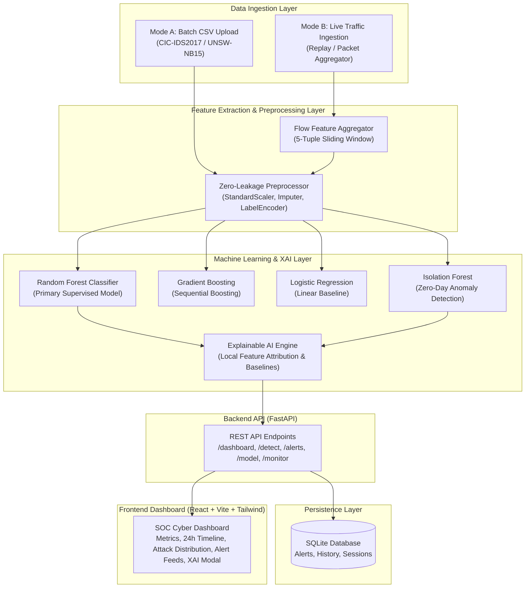

# AI-NIDS: Architectural Design & Data Flow Specification

## 1. System Architecture Overview

The **AI-Based Network Intrusion Detection System (AI-NIDS)** is designed following a modular, asynchronous, service-oriented architecture tailored for real-time cybersecurity operations.

---

## 2. End-to-End Data Flow Pipeline

1. **Traffic Observation / Capture**:
   - Packets are identified by their network 5-tuple: `(Source IP, Destination IP, Source Port, Destination Port, Protocol)`.
   - Packets belonging to the same flow are grouped over a continuous window.

2. **Flow Feature Extraction**:
   - Statistical properties are calculated: duration, packet counts, payload lengths (mean, std, max, min), inter-arrival time (IAT), cumulative TCP flags (SYN, FIN, RST, PSH, ACK), and initial window sizes.
   - Result: A 32-dimensional standardized numerical flow vector.

3. **Zero-Leakage Preprocessing**:
   - Eliminates non-informative identifiers (IPs, Ports, Flow IDs, Timestamps) to prevent model overfitting.
   - Replaces `inf` values and imputes missing cells with training-set medians.
   - Normalizes feature scales using `StandardScaler` fitted exclusively on training splits.

4. **Machine Learning Inference**:
   - **Primary Classifier (Random Forest)**: Evaluates statistical signature against known attack families (DoS-Hulk, DDoS, PortScan, BruteForce, Botnet, Infiltration).
   - **Novelty Detector (Isolation Forest)**: Flags flows that deviate significantly from benign baselines as potential Zero-Day anomalies.

5. **Explainable AI (XAI)**:
   - Evaluates the top contributing features for the alert.
   - Computes divergence from normal baseline values and assigns human-readable cybersecurity reasoning for SOC analysts.

6. **Persistence & Alert Dispatch**:
   - High-severity events are written to the database with status `NEW`.
   - The FastAPI backend updates dashboard telemetry.

7. **SOC Operator Triage**:
   - Analysts view real-time feeds, filter by severity, inspect feature attributions, and update triage status (`ACKNOWLEDGED`, `RESOLVED`, `FALSE_POSITIVE`).

---

## 3. Network Feature Schema (CIC-IDS2017 Compliant)

| Feature Name | Description | Forensic Significance |
| :--- | :--- | :--- |
| `Flow Duration` | Total duration of flow in microseconds | Distinguishes short scanning probes from prolonged connections |
| `Total Fwd Packets` | Cumulative packets sent client → server | Identifies volumetric floods (DoS/DDoS) |
| `Total Backward Packets` | Cumulative packets server → client | Reveals server response ratios and dropped connections |
| `Total Length of Fwd Packets` | Total bytes sent forward | High volumes indicate data infiltration/exfiltration |
| `Flow Bytes/s` & `Flow Packets/s` | Traffic throughput rates | Core volumetric anomaly indicator |
| `Flow IAT Mean & Std` | Packet inter-arrival time statistics | Detects deterministic botnet C2 heartbeats |
| `SYN Flag Count` | TCP SYN synchronization packets | Hallmarks of TCP SYN floods and PortScans |
| `RST Flag Count` | TCP Reset connection attempts | Elevated in BruteForce attacks due to rejected auth |
| `Average Packet Size` | Mean byte length across flow | Separates small-packet stressers from bulk data transfers |
| `Init_Win_bytes_forward` | Initial TCP window advertisement | Helps fingerprint underlying OS and scanning tools |

---

## 4. Security & Least Privilege Design

- **Safe CSV Parsing**: File size bounds (25MB limit) and MIME validation prevent decompression bombs and denial-of-service.
- **No Sensitive Packet Payload Retention**: Payloads and passwords are never parsed or stored, preserving data privacy and PCI-DSS/HIPAA compliance.
- **CORS Whitelisting**: Restricted to designated frontend origins.
- **Authorized Replay Ingestion**: Replay mode simulates authorized traffic flows safely without initiating offensive scans.
